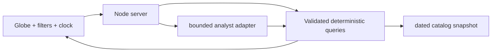

# Architecture

The Node HTTP server serves the browser app and owns the catalog/query boundary. The browser renders the scene and sends bounded natural-language requests to `/api/agent`. Deterministic query functions perform filtering, counts, purpose breakdowns, object lookup, geographic snapshots, and SGP4 propagation. The analyst route handles high-confidence intents through bounded tool-like paths (`countObjects`, `getObject`, `getDatasetStatus`, `getDebrisFacts`, `getHistoricalEvents`, `propagateAtTime`, and `proposeSceneAction`) and uses a server-side Portkey general-answer adapter only for questions that do not require a deterministic numeric query. The browser keeps a short recent conversation so follow-ups such as “Is it worth it?” can resolve against the prior topic. General answers receive compact dataset context and must label estimates and uncertainty. No key or raw OMM record is sent to the browser.

The real snapshot is selected automatically when `data/catalog-real.json` exists. The original 12-record fixture remains available through `ORBITBRIEF_DATA_FILE` for a fast smoke test. The browser uses a WebGL Earth layer with the same yaw/pitch transform as the satellite projection; this keeps geographic landmarks and markers aligned while the user rotates the globe.
